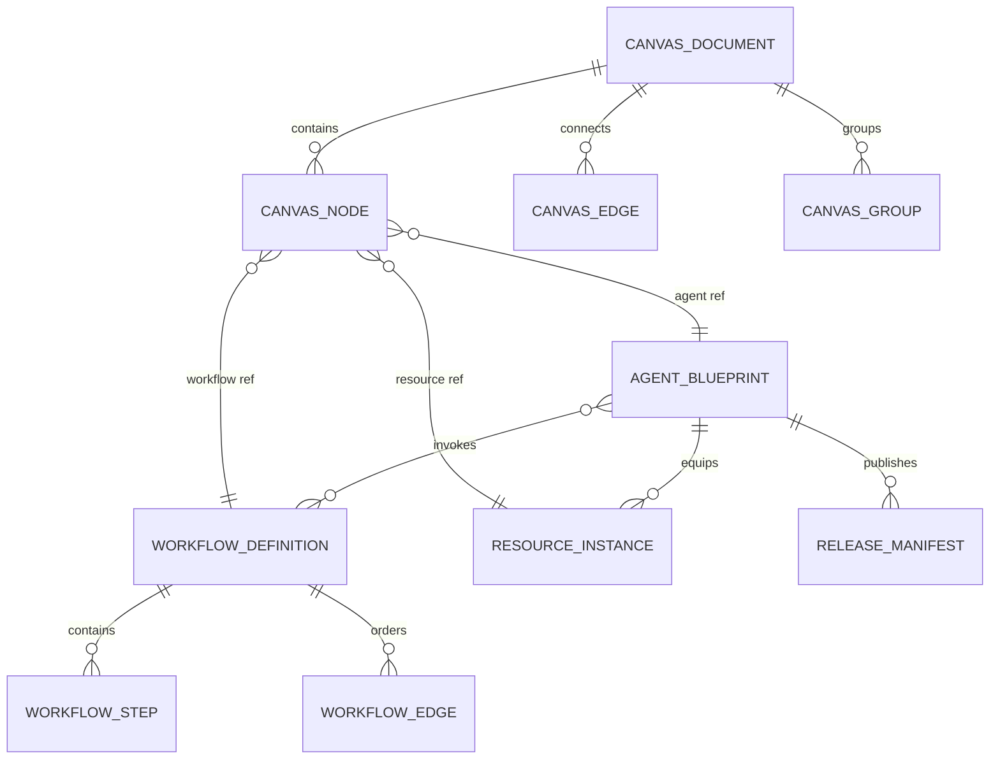
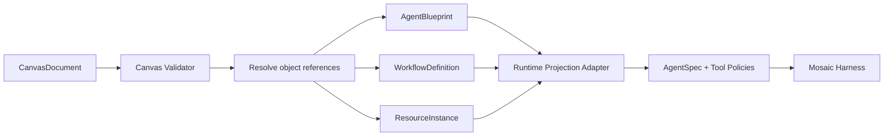

# Mosaic Canvas Contract v1

Status: proposed contract for review  
Canonical artifact: `contracts/canvas-document.schema.json`  
Contract version: `mosaic.canvas/v1`

## 1. Product Boundary

Mosaic Canvas is the low-code/zero-code authoring surface. Mosaic Harness remains
the code-first runtime SDK. They exchange stable domain objects through the
control plane; neither side imports the other's presentation or internal runtime
types.

```text
Studio CanvasDocument
  -> control-plane validation and persistence
  -> AgentBlueprint + WorkflowDefinition + ResourceInstance
  -> runtime projection
  -> Mosaic Harness AgentSpec / tools / policies
```

The canvas contract answers two separate questions:

- **What is arranged on the visual canvas?** `CanvasDocument`.
- **What is executable?** Referenced `AgentBlueprint`, `WorkflowDefinition`, and
  `ResourceInstance` objects compiled by the control plane.

Canvas coordinates, selection, zoom, color, and grouping never enter
`AgentSpec`. Runtime model instances, graph objects, API keys, and Python classes
never enter `CanvasDocument`.

## 2. Ownership And Consumers

| Boundary | Owner | Consumers | Authority |
|---|---|---|---|
| Canvas persistence | Platform control plane | Studio, export/import | `canvas-document.schema.json` |
| Agent runtime definition | Mosaic Harness | Platform compiler, code-first developers | `AgentBlueprint -> AgentSpec` adapter |
| HTTP/SSE transport | Platform API | Studio live client | Future `platform.v1` OpenAPI/AsyncAPI artifact |
| Resource catalog | Platform adapters | Studio palette, compiler | `ResourceDescriptor` public shape |

Contract changes require review by both Studio and platform owners. Mosaic
Harness only reviews changes that alter runtime projection.

## 3. Aggregate Model



### CanvasDocument

Owns presentation and top-level composition:

- opaque canvas ID;
- optimistic-concurrency revision;
- draft/published state;
- nodes, typed edges, groups;
- viewport position and zoom;
- timestamps.

It references executable objects by ID. It does not embed provider credentials,
runtime model objects, Tool implementations, journal events, or compiled graphs.

### AgentBlueprint

Remains the runtime-oriented Agent definition already provided by the platform:

- system prompt;
- primary/fallback model references;
- equipped resource instance references;
- memory and security policy;
- response contract;
- evaluation suite;
- immutable release fingerprint.

The existing `tool_refs` and `skill_refs` fields remain readable during
migration. New canvas work should write `ResourceInstance` references once that
provider contract is implemented.

### ResourceInstance

Represents one configured use of a catalog resource. Multiple instances may
reference the same `resource_id`.

```json
{
  "id": "resource.search-primary",
  "resource_id": "web_search",
  "kind": "tool",
  "display_name": "Primary web search",
  "config": {
    "max_results": 5,
    "allowed_domains": ["example.org"]
  },
  "policy": {
    "approval": "never",
    "credential_ref": null,
    "timeout_seconds": 20,
    "max_retries": 1
  },
  "validation": {
    "status": "valid",
    "errors": [],
    "warnings": [],
    "validated_at": "2026-09-27T10:00:00Z"
  }
}
```

Raw credentials are forbidden. Only `env:` and `keychain:` references cross the
contract boundary.

### WorkflowDefinition

A reusable executable behavior module. It is not the top-level Canvas and it is
not required for an Agent to run.

Initial step types:

- `trigger`;
- `agent`;
- `tool`;
- `condition`;
- `approval`;
- `output`.

An Agent may run in one of three modes:

| Mode | Meaning |
|---|---|
| `agentic` | Agent autonomously chooses Tools, Skills, and Workflows. |
| `workflow_assisted` | Agent remains autonomous but may invoke attached Workflows. |
| `workflow_first` | Workflow controls the main path; Agent performs bounded reasoning steps. |

### CanvasEdge

Top-level relationships are typed and must be semantically valid.

| Edge | Valid source | Valid target | Meaning |
|---|---|---|---|
| `owns` | Agent | Resource | Agent owns a Tool, Skill, Memory, Policy, or Connector instance. |
| `binds` | Agent | Model resource | Agent uses the model binding. |
| `invokes` | Agent | Workflow | Agent may invoke the reusable Workflow. |
| `handoff` | Agent | Agent | Source may transfer a task to target. |
| `feeds` | Workflow | Agent | Workflow output becomes Agent input. |

An invalid source/target combination fails Canvas validation and cannot be
published.

## 4. Invariants

1. Node IDs and edge IDs are opaque strings and unique within a document.
2. Every edge references two existing nodes.
3. No self-edge is permitted for `handoff` or `feeds`.
4. Each `AgentCanvasNode.blueprint_id` resolves to exactly one draft blueprint.
5. Each `WorkflowCanvasNode.workflow_id` resolves to a versioned Workflow.
6. Each `ResourceCanvasNode.resource_instance_id` resolves to a configured
   `ResourceInstance`.
7. An Agent has at most one primary model binding in v1.
8. Workflow attachment does not implicitly change Agent behavior mode.
9. Changing layout does not invalidate runtime validation.
10. Changing a runtime-relevant object marks its validation state `stale`.
11. Published Canvas revisions and Release Manifests are immutable.
12. Secret values are rejected at serialization boundaries.

## 5. Persistence And Concurrency

Studio autosaves the Canvas draft through the control plane. It does not write
directly to Mosaic Harness storage.

Recommended operation:

```http
PUT /canvases/{canvas_id}
If-Match: "revision-12"
Content-Type: application/json
```

Success increments `revision`. A stale revision returns `409 conflict` with the
current revision; the server never silently overwrites another editor's state.

Transient UI state is not persisted:

- currently selected node;
- open modal;
- drag preview;
- temporary connection line;
- validation request spinner;
- unsent text composition.

Viewport is persisted because it affects workspace continuity, not execution.

## 6. Compile Boundary

The platform compiler resolves the Canvas graph without giving Mosaic Harness a
Canvas dependency.



The compiler must report errors by canvas node ID so Studio can highlight the
failing visual object. It must not mutate the Canvas while compiling.

## 7. Validation Levels

| Level | Examples | Runs when |
|---|---|---|
| Schema | Required fields, enums, shape | Every save |
| Reference | Missing blueprint/workflow/resource IDs | Every save and publish |
| Graph | Invalid edge type, cycle policy, missing ports | Every graph change |
| Capability | Model lacks tool calling or structured output | Preview and publish |
| Security | Missing approval, invalid credential ref, denied category | Preview and publish |
| Evaluation | Release thresholds not met | Publish |
| Live probe | Provider credentials/endpoint actually work | Explicit test, optionally publish gate |

Offline validation must not claim that a provider call succeeded.

## 8. Versioning And Compatibility

- `schema_version` is required and exact.
- Additive optional fields may ship within `mosaic.canvas/v1`.
- Enum changes, required-field changes, or semantic changes require
  `mosaic.canvas/v2`.
- Importers reject unknown major versions instead of guessing.
- Export bundles contain CanvasDocument plus referenced public domain objects;
  they never contain raw credentials or runtime journal data.
- The control plane owns v1-to-v2 migrations. Studio does not rewrite stored
  documents independently.

## 9. Why This Is A Mosaic Contract

The contract is not merely a generic graph format. Its typed relationships,
model capability checks, resource policies, validation provenance, evaluation
gates, and immutable releases preserve Mosaic's differentiator:

> Visual composition produces a model-portable, testable, auditable runtime
> artifact, not only a diagram that happens to execute.

