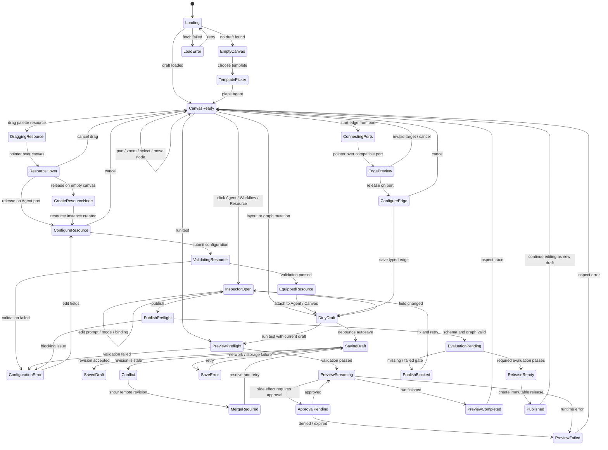
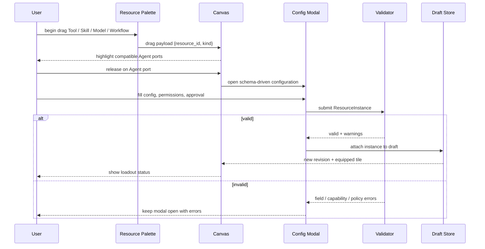
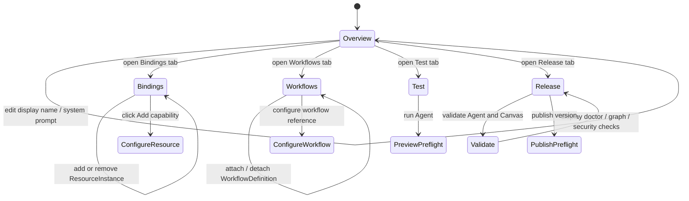

# Mosaic Canvas Interaction State v1

The diagram describes user-visible states and the transitions that are allowed
to mutate the Canvas draft. It deliberately separates transient interaction
state from persisted state.

## 1. End-to-End Interaction State

## 2. Resource Drop State

## 3. Agent Inspector State

## 4. Persisted Versus Ephemeral State

| State | Persisted? | Reason |
|---|---:|---|
| Agent node position | yes | Reopen the workspace where the user left it. |
| Canvas viewport | yes | Preserve workspace orientation. |
| Agent blueprint reference | yes | Runtime compilation input. |
| Resource instance config | yes | Executable behavior and policy. |
| Workflow attachment | yes | Executable capability relationship. |
| Typed Canvas edge | yes | Agent/Workflow composition semantics. |
| Selected node | no | UI-only preference. |
| Open modal | no | Transient interaction. |
| Drag preview line | no | Transient interaction. |
| Loading spinner | no | Request state. |
| Run event trace | no in CanvasDocument | Stored by run journal and referenced by run ID. |

## 5. Failure And Recovery Rules

- A failed resource configuration never creates an equipped instance.
- A stale autosave returns a conflict; it never overwrites the newer revision.
- A rejected edge is removed from the preview and never enters the document.
- Preview can run against a draft snapshot, but it cannot publish or mutate the
  production runtime registry.
- A denied approval ends the affected run with an explicit event; it is not a
  generic tool failure.
- A failed evaluation gate leaves the draft editable and does not create a
  release.
- Browser refresh restores the latest saved document, not unsent transient UI
  state.

